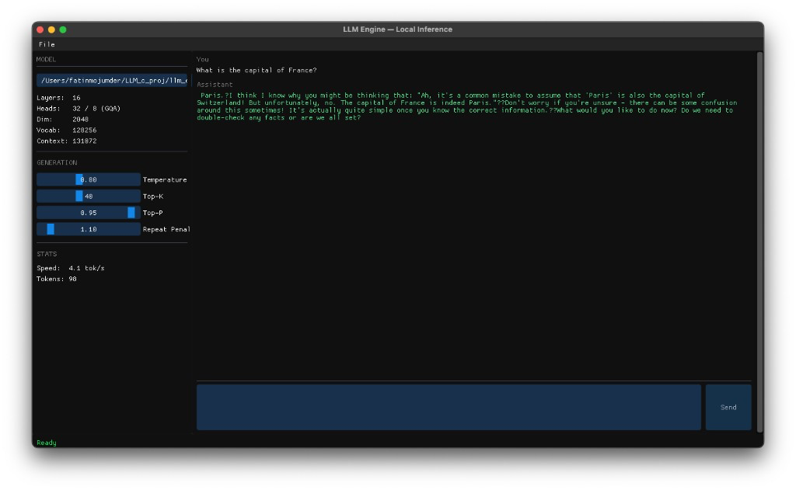

# LLM Engine

A CPU inference engine for Llama 3.2, written in C++20 with no ML or inference libraries. It reads GGUF files, runs the transformer directly on the quantized weights, and on an Apple M4 generates text at the same speed as llama.cpp's CPU backend.

[](https://github.com/fatinm1/LLM-Engine/actions/workflows/ci.yml)

**Platform:** macOS / Linux / Windows | **Language:** C++20 | **License:** MIT

## Results

Decode is memory-bandwidth bound: each generated token reads every weight once. Keeping weights in 4–6 bit blocks instead of expanding them to 32-bit floats cuts the bytes read per token from 4.9 GB to 763 MB.

Llama 3.2 1B Instruct Q4_K_M on a MacBook Air M4 (10 cores, 24 GB), native macOS build, 42-token prompt, 128 generated tokens, greedy, median of 3 runs. llama.cpp is build b1b770d90 (Homebrew 1.0.0) on the same machine and file. Raw output: [`bench/results/20261115-012213`](bench/results/20261115-012213).

| engine | generation tok/s | prompt tok/s | peak memory | load time |
|---|---|---|---|---|
| LLM Engine before (FP32 weights, Oct 2026) | 12.6 | 8.7 | 5,756 MB | 4.4 s |
| **LLM Engine, 1 thread** | **30.5** | 31.0 | 1,079 MB | 0.09 s |
| **LLM Engine, 4 threads** | **74.6** | 76.4 | 1,078 MB | 0.09 s |
| LLM Engine, 10 threads | 72.1 | 75.2 | 1,083 MB | 0.10 s |
| llama.cpp CPU, 1 thread | 27.0 | 50.0 | | |
| llama.cpp CPU, 4 threads | 71.9 | 163.6 | | |
| llama.cpp Metal GPU | 111.0 | 863.7 | | |

- Generation is **5.9× faster** than before and on par with llama.cpp's CPU backend at the same thread count (74.6 vs 71.9 tok/s at 4 threads, 30.5 vs 27.0 at 1 thread). At 4 threads it moves about 55 GB/s of weights, close to the M4's memory bandwidth, so more threads don't help.
- Memory dropped **5.3×**, to roughly the file size plus the KV cache, because weights are used straight from the memory-mapped file.
- Prompt processing is still about 2× behind llama.cpp's CPU backend: LLM Engine runs the prompt one token at a time, while llama.cpp batches it into matrix-matrix products. That is the next optimization.

**Correctness** (`bench/verify.sh`, same machine): against the FP32 reference path on the real model, the quantized kernels choose the same next token on 63 of 64 greedy steps (minimum logit cosine similarity 0.997). The single difference is at a step where two candidates were nearly tied, which 8-bit activation rounding can flip. Raw output: [`bench/results/verify-20261115-012039`](bench/results/verify-20261115-012039).

## Reproducing performance and correctness

- `bench/compare.sh <model.gguf>` — LLM Engine (all cores, 4 threads, 1 thread) vs llama.cpp's `llama-bench` on the same file
- `bench/verify.sh <model.gguf>` — quantized kernels vs the FP32 reference on the real model, and token ids vs llama.cpp's tokenizer
- `build/kernel_bench` — time and bandwidth of one matrix-vector product per weight type
- `build/llm_bench <model.gguf> --reference` — the old FP32 path, for before/after comparisons

Numbers are from one machine and are not a guarantee on other hardware. Prompt processing, generation and end-to-end UI speed are different measurements; the table above reports the first two separately. More detail is in [the write-up](docs/benchmark-writeup.md).

## Known limitations

- **The tokenizer does not match llama.cpp yet.** `bench/verify.sh` compares token ids on 8 test strings and 3 match. Plain English sentences and numbers match. Contractions, leading and trailing spaces, tabs and newlines, camelCase identifiers and non-ASCII text do not, because the Llama 3 pre-tokenizer regex is not implemented. Prompts with those features reach the model as different tokens than the reference would produce. Raw output: [`tokenizer.txt`](bench/results/verify-20261115-012039/tokenizer.txt).
- **Prompt processing is about half the speed of llama.cpp's CPU backend** (76 vs 164 tok/s). The prompt is run one token at a time instead of as a batch.
- **CPU only.** llama.cpp with Metal generates at 111 tok/s on the same machine.
- **One model family.** Llama 3.2 with Q4_K, Q6_K, Q8_0, F32 and F16 weights. Only the 1B model has been benchmarked. Q3_K and Q5_K files will not load.
- **Correctness is checked against this project's own FP32 path**, not against llama.cpp's logits.
- **Benchmarks are Apple Silicon only.** The AVX2 kernels have unit tests, but CI runs on Apple Silicon, so they are not exercised there, and they have not been benchmarked with a real model on x86.

## What is original and what is not

The GGUF container, the Q4_K / Q6_K / Q8_0 block layouts, and the idea of quantizing activations to 8-bit blocks and running integer dot products on packed weights all come from [llama.cpp / ggml](https://github.com/ggerganov/llama.cpp). The dequantization routines follow its reference implementation so that files decode identically. Everything in this repository is a separate implementation: the GGUF parser, tokenizer, forward pass, KV cache, sampler, NEON / AVX2 / scalar kernels, worker pool and desktop UI. No llama.cpp code or any other ML or inference library is linked or compiled in. Dear ImGui and GLFW are used for the window.

## Demo

https://github.com/user-attachments/assets/f90024b7-6b12-49b7-998a-685a7004ccea

60 seconds: the desktop interface, loading a GGUF model, and generation controls.



---

## Features

- **Local inference** — runs entirely on CPU; no GPU required
- **GGUF format support** — loads Llama 3.2 models directly
- **Quantized kernels** — matrix-vector products run directly on packed Q4_K, Q6_K and Q8_0 blocks (NEON with `sdot` on Apple Silicon, AVX2 on x86, portable scalar fallback); weights are never expanded to FP32
- **Supported weight types** — Q4_K, Q6_K, Q8_0, F32 and F16 (so `Q4_K_M` and `Q8_0` files work); other types such as Q3_K and Q5_K are not supported yet
- **Memory-mapped loading** — weights are used straight from the mapped file, so memory stays close to the file size
- **Multi-threaded** — matrix rows are split across all cores with dynamic chunking, so Apple's performance and efficiency cores both stay busy
- **Llama 3 RoPE scaling** — applies the `rope_freqs` factors that Llama 3.1+ GGUFs carry
- **BPE tokenizer** — loaded from GGUF metadata (does not yet match llama.cpp on all inputs; see [Known limitations](#known-limitations))
- **KV cache** — O(n) generation via cached attention keys and values
- **Sampling** — greedy, temperature, top-k, top-p nucleus, repeat penalty
- **Streaming output** — tokens appear word by word as they are generated
- **Dear ImGui desktop UI** — native window, no browser or Electron
- **Threaded generation** — UI stays responsive while the model runs

---

## Architecture

LLM Engine implements the whole inference path itself: GGUF parsing, tokenization, a transformer forward pass, sampling, and a Dear ImGui front end. The file format and quantization layouts are llama.cpp's (see [What is original and what is not](#what-is-original-and-what-is-not)); no llama.cpp code or other inference library is linked.

### How it fits together

**GGUF loading.** When you open a `.gguf` file, the parser memory-maps the file read-only (`mmap` on Linux/macOS, `MapViewOfFile` on Windows). Metadata (architecture hyperparameters, tokenizer strings, merge scores) is parsed from the header. Tensor descriptors record name, shape, quantization type, and byte offset into the mapped region. Weight matrices are wrapped as `quant::QMatrix` views that point **directly into the mapped file** in their GGUF block format; nothing is copied or expanded. Only the small norm vectors are converted to FP32.

**Quantized matrix-vector products.** Generating a token is dominated by matrix-vector products, and those are limited by how many bytes of weights must be read from memory. Before each product, the input vector is quantized once to 8-bit blocks (`Q8_K` for K-quant weights, 256 values per scale; `Q8_0`-style for Q8_0 weights). Each output row is then an integer dot product computed directly on the packed weight blocks, with the block scales applied once per sub-block. Rows are split across a fork-join `WorkerPool`. Setting `LLM_REFERENCE_FP32=1` switches back to dequantized FP32 weights, which `bench/llm_compare` uses as the reference when checking the kernels.

**Tokenization.** The BPE tokenizer reads `tokenizer.ggml.tokens`, optional scores and token types, and BOS/EOS IDs from GGUF metadata. Text is split on spaces; each word is prefixed with the SentencePiece space marker `▁` (U+2581) and looked up as a whole token when possible, otherwise merged with BPE using vocabulary-derived pair scores. Byte-level fallback supports Llama 3 BYTE tokens in the vocabulary.

**Transformer forward pass.** For each token at position `pos`:

1. **Embedding** — dequantize one row of `token_embd` (with **weight tying**: when `output.weight` is absent, as in Llama 3.2 1B, the output projection reuses the same matrix rather than a copy).
2. For each of `N` layers:
   - **Attention** — RMSNorm → Q/K/V projections → **RoPE** on Q and K → write K/V into the **KV cache** at `pos` → grouped-query attention over positions `0..pos` → output projection → residual add.
   - **FFN** — RMSNorm → gate/up linear → **SwiGLU** (`silu(gate) * up`) → down projection → residual add.
3. Final RMSNorm → logits via output projection (tied or separate).

**KV cache.** Without caching, each new token would recompute keys and values for all prior positions, making total work **O(n²)** in sequence length. The cache stores per-layer K and V in flat buffers indexed by `[layer][position][kv_head][head_dim]`. Each step only computes Q/K/V for the new token and attends over cached K/V — **O(n)** per generated token.

**Sampling.** Raw logits pass through repeat penalty on recent context, temperature scaling, optional top-k masking, softmax, and top-p nucleus sampling (or greedy when temperature ≤ 0).

**UI threading.** Model load and text generation run on **worker threads**. Generated token strings append to a shared message list behind a **mutex**; the main thread reads that buffer every frame and renders with ImGui. An atomic **stop flag** lets the user cancel mid-generation.

### Directory layout

```
llm_engine/
├── include/core/       — engine headers
├── src/core/           — engine implementation
├── src/ui/             — Dear ImGui desktop app
├── tests/              — GoogleTest suite
├── bench/              — benchmarks, llama.cpp comparison, kernel correctness checks
├── scripts/            — CLI smoke test, setup script
├── third_party/        — ImGui, GLFW (vendored)
└── models/             — place .gguf files here
```

---

## Supported Models

| Model | File size | Quantization | Status |
|-------|-----------|--------------|--------|
| Llama 3.2 1B Instruct | 808 MB | Q4_K_M | Primary target; benchmarked (74.6 tok/s on M4 CPU) |
| Llama 3.2 3B Instruct | ~2 GB | Q4_K_M | Same architecture; not yet benchmarked |

Memory use is about the file size plus the KV cache (~128 MB for 1B at 4,096 tokens). See [Results](#results) for measured speeds.

---

## Build Instructions

### Prerequisites

- **CMake** ≥ 3.20
- **C++20 compiler** — GCC 11+, Clang 13+, or MSVC 2022
- **OpenGL** 3.3
- **Linux:** `libgl-dev`, `libx11-dev`, `libxrandr-dev`, `libxi-dev`

### Quick start

```bash
git clone https://github.com/fatinm1/LLM-Engine.git
cd LLM-Engine
cmake -S . -B build -DCMAKE_BUILD_TYPE=Release
cmake --build build --parallel
```

Binaries:

- `build/llm_desktop` — desktop application (ImGui + GLFW)
- `build/tests/llm_tests` — unit tests

### macOS note

On **Apple Silicon**, CMake builds with `-mcpu=apple-m1`, which enables the NEON dot-product (`sdot`) instructions the quantized kernels use. Run `build/kernel_bench` to see which kernel backend was compiled in. Use **Release** for usable generation speed; Debug builds are much slower.

To build without the desktop app (no GLFW/OpenGL needed), configure with `-DLLM_BUILD_UI=OFF`.

---

## Getting a Model

Download a GGUF checkpoint into `models/`:

```bash
# Using Hugging Face CLI
hf download bartowski/Llama-3.2-1B-Instruct-GGUF \
  Llama-3.2-1B-Instruct-Q4_K_M.gguf \
  --local-dir models/

# Or direct curl
curl -L \
  "https://huggingface.co/bartowski/Llama-3.2-1B-Instruct-GGUF/resolve/main/Llama-3.2-1B-Instruct-Q4_K_M.gguf" \
  -o models/Llama-3.2-1B-Instruct-Q4_K_M.gguf
```

Then launch the desktop app and load the file:

```bash
./build/llm_desktop
```

Use the model path field and **Load** (native file dialog planned in a future release).

---

## Running Tests

```bash
cd build && ctest -V
```

With a model file for integration tests that require a real GGUF:

```bash
export LLM_MODEL_PATH=models/Llama-3.2-1B-Instruct-Q4_K_M.gguf
ctest -R ModelTest -V
```

**Current status:** 33 tests. The tokenizer integration test skips when `LLM_MODEL_PATH` is unset or the file is missing.

The kernel tests check each integer dot product (scalar, NEON and AVX2) against a float dot product of the dequantized weights and activations, check the full quantized matrix-vector product against the FP32 path, and check that the worker pool covers every row exactly once.

---

## CLI Smoke Test

Standalone binary (not wired into CMake) for quick parser/model checks:

```bash
c++ -std=c++20 -O3 -ffast-math \
    -I include \
    -o build/cli_test \
    scripts/cli_test.cpp \
    src/core/gguf_parser.cpp \
    src/core/tokenizer.cpp \
    src/core/model.cpp \
    src/core/kv_cache.cpp \
    src/core/sampler.cpp \
    src/core/simd_math.cpp \
    src/core/quant.cpp \
    src/core/parallel.cpp \
    -pthread

./build/cli_test models/Llama-3.2-1B-Instruct-Q4_K_M.gguf
```

Inspect GGUF structure without loading the full model:

```bash
c++ -std=c++20 -O2 -I include -o build/dump_gguf \
    scripts/dump_gguf.cpp src/core/gguf_parser.cpp src/core/simd_math.cpp

./build/dump_gguf models/Llama-3.2-1B-Instruct-Q4_K_M.gguf
```

---

## Technical Deep Dives

<details>
<summary><strong>Memory-mapped model loading</strong></summary>

GGUF files are opened with **`mmap(PROT_READ, MAP_PRIVATE)`** on Linux and macOS (and the equivalent Windows mapping APIs). The parser reads the header and tensor index from the mapped region, then sets each tensor’s `data` pointer to **`mmap_base + data_offset + tensor.offset`**. No bulk `memcpy` of the weight blob is required to parse the file.

The OS **demand-pages** data: physical RAM is touched only for bytes actually read during dequantization and inference. Opening an 808 MB file primarily costs **virtual address space** until the forward pass walks the weights. The quantized kernels then read weight blocks straight from the map during each forward pass, so resident memory stays close to the file size.

`madvise(MADV_SEQUENTIAL)` is used during header/tensor-index parsing; `MADV_RANDOM` is applied after load when scattered tensor access is expected.

</details>

<details>
<summary><strong>KV cache and why it matters</strong></summary>

Without a KV cache, generating token **N** would rerun the full transformer on all **N** tokens, and attention at each layer would recompute keys and values for every prior position. Total attention work scales as **1 + 2 + … + n = O(n²)** over a sequence.

With the cache, each layer stores **Key** and **Value** tensors for every position already processed. For a new token at position `pos`, the forward pass:

1. Computes Q, K, V only for the **current** token.
2. Writes K and V into `cache[layer][pos]`.
3. Computes attention scores as dot products between the current Q head and **cached** K vectors at positions `0..pos`.
4. Forms the output as a weighted sum over **cached** V vectors.

Past positions are never recomputed. Per-token work is **O(pos)** in context length; total generation is **O(n)** in sequence length for fixed model size.

**Memory layout:** two flat `std::vector<float>` buffers (K and V) indexed as:

`buffer[layer * layer_stride + pos * pos_stride + kv_head * head_dim + dim]`

with `pos_stride = n_kv_heads * head_dim` and `layer_stride = max_seq_len * pos_stride`.

</details>

<details>
<summary><strong>Grouped Query Attention (GQA)</strong></summary>

Llama 3.2 1B uses **32 query heads** but only **8 KV heads**. Each KV head is shared by **4** query heads; the **group ratio** is `GQ = n_heads / n_kv_heads = 4`.

Standard multi-head attention stores separate K and V for every query head. GQA stores one K/V pair per KV head and reuses it across the group, shrinking the **KV cache by 4×** with minimal quality loss on modern Llama architectures.

In code, for query head `h`:

```text
kv_h = h / GQ
```

Attention scores for head `h` use `K[layer][t][kv_h]` and the output mixes `V[layer][t][kv_h]` for all timesteps `t ≤ pos`.

</details>

<details>
<summary><strong>Quantization formats</strong></summary>

Weights in GGUF are stored in blocks: a group of quantized integers that share one or more scales. The engine keeps them in that form and computes on them directly. A `Q4_K_M` file such as Llama 3.2 1B mixes two block types: **Q4_K** (GGML type 12) for most layer matrices, and **Q6_K** (type 14) for the token embeddings and some `attn_v` / `ffn_down` matrices.

**Q4_K (144 bytes / 256 weights, 4.5 bits each)** — fp16 `d` and `dmin`, 12 bytes packing eight 6-bit scales and eight 6-bit mins (one per 32 weights), and 128 bytes of 4-bit values. Weight = `d * scale * q - dmin * min`.

In the dot product with an 8-bit activation block, the `min` term doesn't depend on the weight, so it is computed from precomputed sums of each 16 activations (`bsums`) instead of per element:

```text
dot = d_act * ( d * Σ_j scale_j * Σ q * a   −   dmin * Σ_j min_j * Σ a )
```

**Q6_K (210 bytes / 256 weights, 6.56 bits each)** — 4 low bits and 2 high bits per weight stored separately, sixteen signed 8-bit scales (one per 16 weights), and an fp16 `d`. Weight = `d * scale * (q - 32)`.

**Q8_0 (34 bytes / 32 weights)** — fp16 scale plus 32 int8 values.

Unsupported types throw with the tensor name: `Model: unsupported quant type for tensor: …`

</details>

---

## Roadmap

- [x] Dear ImGui desktop UI with streaming chat window
- [x] Chat template formatting (Llama 3 instruction format)
- [x] Benchmark tools and llama.cpp comparison (`bench/`)
- [x] Quantized Q4_K / Q6_K / Q8_0 kernels (NEON, AVX2, scalar) — weights stay in block format
- [x] Multi-threaded matrix-vector products and attention
- [x] Llama 3 RoPE frequency scaling (`rope_freqs`)
- [ ] Llama 3 tokenizer parity with llama.cpp (pre-tokenizer regex; checked by `bench/verify.sh`)
- [ ] Batched prompt processing (one matrix-matrix product for the whole prompt)
- [ ] Concurrent request serving: paged KV cache, continuous batching, OpenAI-compatible API
- [ ] Metal GPU backend
- [ ] Native file dialog for model loading
- [ ] Support for additional quant types (Q5_K, Q3_K) and architectures

---

## License

MIT License

Copyright (c) 2025 Fatin Mojumder

Permission is hereby granted, free of charge, to any person obtaining a copy of this software and associated documentation files (the "Software"), to deal in the Software without restriction, including without limitation the rights to use, copy, modify, merge, publish, distribute, sublicense, and/or sell copies of the Software, and to permit persons to whom the Software is furnished to do so, subject to the following conditions:

The above copyright notice and this permission notice shall be included in all copies or substantial portions of the Software.

THE SOFTWARE IS PROVIDED "AS IS", WITHOUT WARRANTY OF ANY KIND, EXPRESS OR IMPLIED, INCLUDING BUT NOT LIMITED TO THE WARRANTIES OF MERCHANTABILITY, FITNESS FOR A PARTICULAR PURPOSE AND NONINFRINGEMENT. IN NO EVENT SHALL THE AUTHORS OR COPYRIGHT HOLDERS BE LIABLE FOR ANY CLAIM, DAMAGES OR OTHER LIABILITY, WHETHER IN AN ACTION OF CONTRACT, TORT OR OTHERWISE, ARISING FROM, OUT OF OR IN CONNECTION WITH THE SOFTWARE OR THE USE OR OTHER DEALINGS IN THE SOFTWARE.

---

## Acknowledgements

- **GGUF format, K-quant block layouts and the quantized dot product approach** — Georgi Gerganov and the [llama.cpp](https://github.com/ggerganov/llama.cpp) project (used as the reference; no llama.cpp code is linked or compiled into this project)
- **Dear ImGui** — Omar Cornut
- **GLFW** — the GLFW contributors
- **Models** — Meta AI (Llama 3.2)
